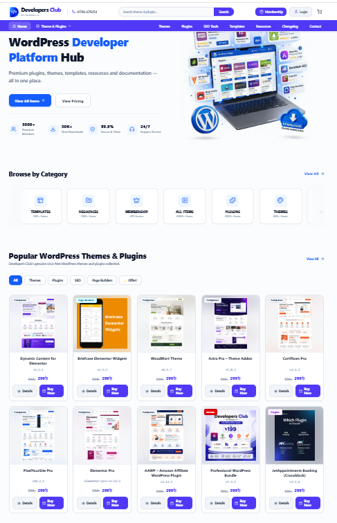
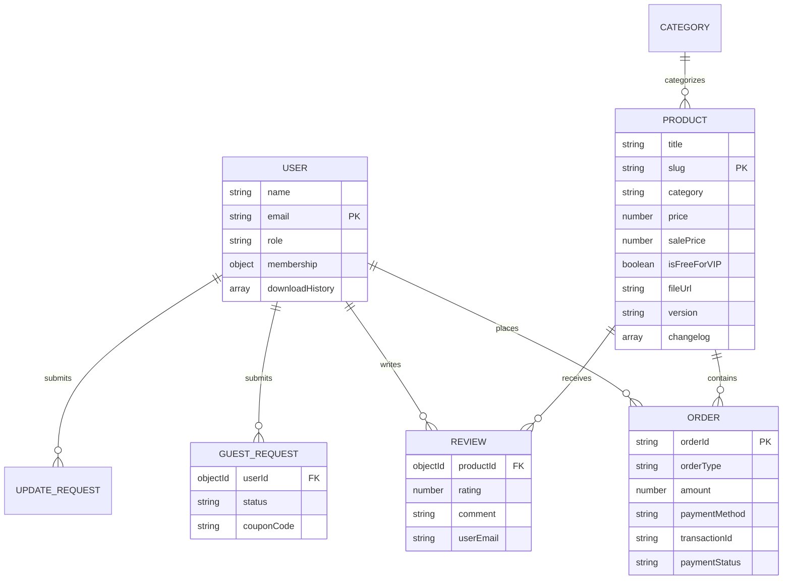

<div align="center">

# ⚡ Developers Club

### Premium WordPress Developer Platform & Subscription Marketplace

<p align="center">
  
</p>

A full-stack, enterprise-grade digital marketplace and subscription management platform built with **Next.js 16 (App Router)**, **React 19**, **Tailwind CSS v4**, **MongoDB**, and **Better Auth**. Designed for WordPress developers, agencies, and creators to access GPL plugins, themes, templates, and web development resources seamlessly.

[](https://subscription-based-project.vercel.app/)
[](https://github.com/eyasinarafat3485-gif/Subscription-Based-Project)
[](https://nextjs.org/)
[](https://react.dev/)
[](https://tailwindcss.com/)
[](https://www.mongodb.com/)
[](#-license)

<br />

[Explore Features](#-core-features) • [Tech Stack](#-tech-stack) • [Getting Started](#-getting-started) • [Environment Variables](#-environment-variables) • [Database Models](#-database-schemas--models) • [API Routes](#-api-architecture) • [Deployment](#-deployment)

---

</div>

## 🌐 Live Production URL

- **Production App:** [https://subscription-based-project.vercel.app/](https://subscription-based-project.vercel.app/)
- **Repository:** [eyasinarafat3485-gif/Subscription-Based-Project](https://github.com/eyasinarafat3485-gif/Subscription-Based-Project)

---

## 📌 Executive Summary

**Developers Club** (`dev-pro`) bridges the gap between digital asset creators and web developers. It delivers a streamlined, subscription-driven catalog of premium WordPress plugins, themes, Elementor kits, and web resources with:

- Tiered subscription memberships and download quota management.
- Multi-channel checkout supporting localized payment methods (**bKash**, **Nagad**, **Rocket**) alongside international processors (**Stripe**, **SSLCommerz**).
- Dynamic multi-role architecture separating **Admin**, **Registered User**, and **Guest** privileges.
- Real-time product versioning, changelog tracking, and asset update requests.

---

## ✨ Core Features

### 💎 1. Membership & Subscription Model
- **Flexible Subscription Tiers:** Free, Pro, VIP, and Agency plans with customized download quotas.
- **Quota Tracking & Enforcement:** Real-time tracking of daily download limits (`downloadsToday`, `dailyLimit`) with automated reset logic.
- **VIP Instant Access:** Free single-click downloads for verified VIP members across eligible plugins and themes.
- **Automated Lifecycle Management:** Tracks plan start/end dates and membership validity.

### 📦 2. Digital Assets Marketplace
- **Search & Filter:** Instant search, subcategory grouping, tags, and category-based dynamic routing (`/product-category/[category]`).
- **Product Details:** Live demo preview embeds, technical specs, version tags, changelogs, and direct file downloads.
- **Reviews & Ratings:** Community-driven star ratings with verified review submissions and admin moderation.
- **Asset Update Requests:** Built-in form allowing developers to request updates for newer versions with WhatsApp/email notification alerts.

### 🛡️ 3. Role-Based Access Control (RBAC)
- **Admin Dashboard (`/dashboard/admin`):**
  - **Catalog Management:** Create, edit, and categorize plugins, themes, and templates.
  - **User & Role Administration:** View registered users, update permissions, toggle roles (`user`, `guest`, `admin`).
  - **Orders & Revenue Analytics:** Audit incoming transactions, inspect payment slips/TXN IDs, and update order statuses.
  - **Coupons & Promo Codes:** Issue discount codes and approve guest trial access.
  - **Guest Request Moderation:** Multi-state lifecycle pipeline (`REQUESTED` → `COUPON_SENT` → `COUPON_SUBMITTED` → `APPROVED` → `REJECTED`).
  - **Public Collections & Attributes:** Curate featured collections, brands, and product attributes.
- **User Dashboard (`/dashboard/user`):**
  - **Download Vault:** Personal download history with quick re-download links.
  - **My Collections:** Bookmarked assets and personalized libraries.
  - **Account Settings & Notifications:** Profile customization, security settings, and platform notifications.
- **Guest Dashboard (`/dashboard/guest`):**
  - Sandbox view, trial coupon status tracker, and guest-to-member upgrade flow.

### 💳 4. Checkout & Payment Engine
- **Multi-Gateway Support:**
  - 🇧🇩 **Local Gateways:** bKash, Nagad, Rocket (with transaction ID verification and sender phone validation).
  - 🌐 **Global Gateways:** Stripe & SSLCommerz integration.
- **Coupon Validation System:** Real-time coupon verification with instantaneous discount recalculation.
- **Order Audit Trail:** Persistent order records with unique alphanumeric Order IDs, tracking statuses (`pending`, `completed`, `failed`).

### 🔐 5. Modern Authentication & Security
- Powered by **Better Auth** supporting Google OAuth2 and password-based credentials.
- Multi-factor OTP verification (`/api/auth/send-otp`, `/api/auth/verify-otp`).
- Disposable email validation and anti-abuse safeguards (`lib/email-validator.js`).
- Secure session management and route protection across client and server boundaries.

---

## 🛠️ Tech Stack

| Domain | Technology / Library | Description |
| :--- | :--- | :--- |
| **Framework** | [Next.js 16 (App Router)](https://nextjs.org/) | Hybrid Server & Client Rendering, API Route handlers |
| **Frontend** | [React 19](https://react.dev/) | Modern concurrent UI architecture |
| **Styling** | [Tailwind CSS v4](https://tailwindcss.com/) | Next-generation utility-first styling engine |
| **Typography** | [Next Font](https://nextjs.org/docs/app/building-your-application/optimizing/fonts) | `Outfit` & `Hind Siliguri` Google Fonts |
| **Icons** | [Lucide React](https://lucide.dev/) | Clean, scalable vector UI icons |
| **Animations** | [Framer Motion](https://www.framer.com/motion/) | Smooth UI micro-interactions, modals, and page transitions |
| **Database** | [MongoDB](https://www.mongodb.com/) & [Mongoose 9](https://mongoosejs.com/) | Schema-driven NoSQL database ODM |
| **Authentication** | [Better Auth](https://www.better-auth.com/) | Authentication engine with Google OAuth & OTP support |
| **Email Service** | [Nodemailer](https://nodemailer.com/) | Transactional email delivery and OTP verification |
| **Notifications** | [React Toastify](https://fkhadra.github.io/react-toastify/) | Interactive, accessible toast notifications |
| **Hosting** | [Vercel](https://vercel.com/) | Production edge deployment with automatic SSL |

---

## 📂 Project Architecture

```
dev-pro/
├── app/                                 # Next.js App Router root
│   ├── (public pages)
│   │   ├── changelog/                   # Platform changelogs & release notes
│   │   ├── checkout/                    # Checkout with multi-gateway payments
│   │   ├── contact/                     # Contact and customer support
│   │   ├── login/ & register/           # Better-Auth authentication pages
│   │   ├── membership/                  # Pricing tiers & subscription plans
│   │   ├── my-account/                  # User profile and account manager
│   │   ├── product-category/[category]/ # Dynamic category filtering pages
│   │   ├── products/[slug]/             # Product details, reviews & downloads
│   │   ├── resources/ & templates/      # Free & VIP resource hubs
│   │   ├── layout.jsx                   # Root application layout & font loader
│   │   └── page.jsx                     # High-converting landing homepage
│   │
│   ├── dashboard/                       # Protected Role-Based Dashboards
│   │   ├── admin/                       # Comprehensive Admin Management Suite
│   │   │   ├── add-product/             # Product upload & version creator
│   │   │   ├── all-products/            # Product catalog inventory manager
│   │   │   ├── all-users/               # User directory & role editor
│   │   │   ├── categories/ & brands/    # Taxonomy and taxonomy relation manager
│   │   │   ├── get-cupon/               # Coupon creation & management
│   │   │   ├── reviews/                 # Community review moderation
│   │   │   └── public-collections/      # Curated promotional bundles
│   │   ├── user/                        # Member dashboard (Vault, Collections, Profile)
│   │   └── guest/                       # Guest sandbox & coupon application tracker
│   │
│   └── api/                             # RESTful API Endpoints
│       ├── admin/                       # Admin telemetry, stats, and approvals
│       ├── auth/                        # Better Auth handler, OTP sender/verifier
│       ├── categories/                  # Category CRUD operations
│       ├── checkout/                    # Order processing and webhook handlers
│       ├── coupons/                     # Discount code validation engine
│       ├── products/                    # Product catalog querying & downloads
│       ├── reviews/                     # Product feedback & rating endpoints
│       └── user/                        # User profile, history & collection APIs
│
├── components/                          # Reusable UI Components
│   ├── dashboard/                       # Dashboard header, sidebar, navigation views
│   ├── Header.jsx & Footer.jsx          # Main navigation bar and footer
│   ├── Hero.jsx & Features.jsx          # Landing page marketing components
│   ├── CategoryGrid.jsx                 # Dynamic categories visual grid
│   ├── PluginGrid.jsx                   # Product showcase & download cards
│   ├── Pricing.jsx                      # Membership tiers & checkout triggers
│   ├── Testimonials.jsx & Articles.jsx  # Social proof & knowledge base
│   ├── AuthModal.jsx & DemoModal.jsx    # Interactive modal dialogs
│   └── TopLinearLoader.jsx              # Navigation loading bar
│
├── lib/                                 # Shared Utilities & Configurations
│   ├── auth.js                          # Better Auth server configuration
│   ├── auth-client.js                   # Client authentication hooks & methods
│   ├── db.js                            # MongoDB connection pooler (cached)
│   ├── email-validator.js               # Disposable email detection
│   └── pagination.js                    # Pagination helper utilities
│
├── models/                              # Mongoose Database Schemas
│   ├── Category.js                      # Categories & asset count
│   ├── GuestRequest.js                  # Guest trial & coupon request lifecycle
│   ├── Order.js                         # Transactions, gateway details, orders
│   ├── Product.js                       # Products, files, versions, changelog
│   ├── Review.js                        # Product star ratings & comments
│   ├── UpdateRequest.js                 # Member version upgrade requests
│   └── User.js                          # RBAC User profile, subscriptions, downloads
│
├── public/                              # Static public assets, logos, and icons
├── package.json                         # Project dependencies and run scripts
└── README.md                            # Project documentation
```

---

## 🗄️ Database Schemas & Models



---

## 🔌 API Architecture

| Endpoint | Method | Role | Description |
| :--- | :---: | :---: | :--- |
| `/api/auth/[...all]` | `ALL` | Public | Better-Auth authentication handler |
| `/api/auth/send-otp` | `POST` | Public | Generates and sends OTP verification code |
| `/api/auth/verify-otp` | `POST` | Public | Validates user-submitted OTP |
| `/api/products` | `GET`, `POST` | Public / Admin | Fetch product catalog or create new products |
| `/api/categories` | `GET`, `POST` | Public / Admin | Retrieve all categories with counts or create |
| `/api/checkout` | `POST` | User | Initializes single/membership order and records payment |
| `/api/coupons` | `POST` | Public | Validates discount coupon codes |
| `/api/reviews` | `GET`, `POST` | Public / User | Fetch product reviews or submit a new review |
| `/api/admin/stats` | `GET` | Admin | Fetches revenue, user, and order telemetry |
| `/api/admin/users` | `GET`, `PATCH` | Admin | Retrieve user lists and manage RBAC roles |
| `/api/admin/guest-requests` | `GET`, `POST`, `PATCH` | Admin | Guest trial and coupon request workflows |

---

## 🚀 Getting Started

Follow these instructions to run the application locally in your development environment.

### 1. Prerequisites
Ensure you have the following installed on your machine:
- **Node.js:** `v18.18.0` or higher (Node `v20+` recommended)
- **Package Manager:** `npm`, `yarn`, `pnpm`, or `bun`
- **Database:** A running local **MongoDB** instance or a [MongoDB Atlas](https://www.mongodb.com/atlas) cloud cluster URI.

### 2. Clone Repository
```bash
git clone https://github.com/eyasinarafat3485-gif/Subscription-Based-Project.git
cd Subscription-Based-Project
```

### 3. Install Dependencies
```bash
npm install
# or
pnpm install
# or
yarn install
```

### 4. Setup Environment Variables
Create a `.env.local` file in the root directory by duplicating the template:

```bash
cp .env.example .env.local
```

Populate the required keys (see [Environment Variables](#-environment-variables)).

### 5. Start Development Server
```bash
npm run dev
```

Open [http://localhost:3000](http://localhost:3000) in your web browser to view the application.

---

## 🔐 Environment Variables

The project requires the following environment variables to be configured in `.env.local`:

```env
# ==========================================
# Application Configuration
# ==========================================
NEXT_PUBLIC_APP_URL=http://localhost:3000

# ==========================================
# MongoDB Database
# ==========================================
MONGODB_URI=mongodb+srv://<username>:<password>@cluster.mongodb.net/dev-pro?retryWrites=true&w=majority

# ==========================================
# Better Auth Configuration
# ==========================================
BETTER_AUTH_SECRET=your_super_secret_jwt_key_here
BETTER_AUTH_URL=http://localhost:3000

# ==========================================
# Google OAuth 2.0 (Optional for Social Login)
# ==========================================
GOOGLE_CLIENT_ID=your_google_client_id.apps.googleusercontent.com
GOOGLE_CLIENT_SECRET=your_google_client_secret

# ==========================================
# SMTP / Email Configuration (Nodemailer)
# ==========================================
SMTP_HOST=smtp.gmail.com
SMTP_PORT=587
SMTP_USER=your_email@gmail.com
SMTP_PASS=your_email_app_password
```

---

## 🚢 Deployment

### Deploying to Vercel

The application is optimized for deployment on the [Vercel Platform](https://vercel.com/):

1. Push your latest code changes to your GitHub / GitLab repository.
2. Go to the [Vercel Dashboard](https://vercel.com/new) and import your repository.
3. In the project **Environment Variables** configuration, add all keys defined in `.env.local`:
   - `MONGODB_URI`
   - `BETTER_AUTH_SECRET`
   - `BETTER_AUTH_URL` (Set to your Vercel URL, e.g. `https://subscription-based-project.vercel.app`)
   - `NEXT_PUBLIC_APP_URL` (Set to `https://subscription-based-project.vercel.app`)
   - `GOOGLE_CLIENT_ID` & `GOOGLE_CLIENT_SECRET` (if using Google OAuth)
4. Click **Deploy**. Vercel will build the Next.js 16 application and deploy it to a global edge network.

---

## 🤝 Contributing

Contributions, issues, and feature requests are welcome!

1. Fork the repository
2. Create your feature branch (`git checkout -b feature/AmazingFeature`)
3. Commit your changes (`git commit -m 'Add some AmazingFeature'`)
4. Push to the branch (`git push origin feature/AmazingFeature`)
5. Open a Pull Request

---

## 📄 License

Distributed under the **MIT License**. See `LICENSE` for more information.

---

<div align="center">
  <sub>Built with ❤️ by <a href="https://github.com/eyasinarafat3485-gif">Eyasin Arafat</a> & the Developers Club team.</sub>
</div>
